<p align="center">
  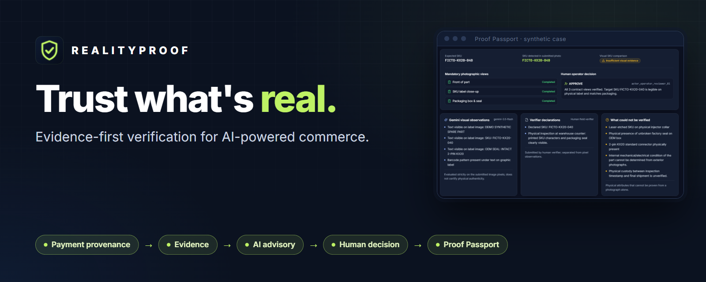
</p>

<p align="center">
  <a href="LICENSE"></a>
  
  
  
  
</p>

**RealityProof lets a buyer, or an AI agent buying on someone's behalf, pay for evidence before paying for a part.** A verifier photographs the actual item, Gemini reports what it can and can't see, a human makes the decision, and a Proof Passport records what was checked and what remains unproven.

> **Prototype for the PayPal AI Hackathon 2026.** All money is PayPal Sandbox test money. Every image is a labelled synthetic fixture of a fictional part, and no physical inspection has taken place. A matching label or an intact hash does not prove a product is genuine.

## Contents

[What is RealityProof?](#what-is-realityproof) · [Why it matters](#why-it-matters) · [Walkthrough](#product-walkthrough) · [How it works](#how-it-works) · [Architecture](#system-architecture) · [PayPal](#paypal-integration) · [Gemini](#gemini-ai) · [Human in the loop](#human-in-the-loop) · [Proof Passport](#proof-passport) · [Agent](#agentic-capabilities) · [Quick start](#quick-start) · [Testing](#testing) · [Security](#security-and-privacy) · [Limitations](#known-limitations) · [Video](#demo-video) · [License](#license)

## What is RealityProof?

AI agents can compare prices and start a checkout in seconds. What they can't do is find out whether the exact part, with the exact SKU, is physically on a shelf before the money moves. A payment record proves that money moved. It says nothing about the object.

RealityProof adds one step before payment. The requester describes the part and the SKU they were promised, decides whether a check is worth its cost, and funds it through PayPal. A verifier follows a guided checklist and uploads one photo per required view. Gemini analyses the pixels and states its own uncertainty. An operator who is neither the requester nor the verifier makes the decision. The result is a Proof Passport that keeps three things apart: the integrity of the record, the human review, and physical truth, which it never claims.

## Why it matters

- **A wrong part is expensive.** In spare-parts procurement, a mismatched SKU means returns, downtime and disputes. A small, targeted check can cost far less than the mistake, and RealityProof shows when it does.
- **Agents need a brake they can call.** An external agent can commission a check through the REST API and then wait for a human decision, instead of paying blind.
- **It refuses to overclaim.** Most verification tools present a photo, a hash or a model score as proof. RealityProof labels each piece of evidence for what it is, and says plainly what it could not verify.

## Product walkthrough

Real captures from the running product: the read-only public demo and a local full workflow on a synthetic case.

| Requester: every request and where its money came from | Value of Information: buy a check only when it's worth it |
|---|---|
| 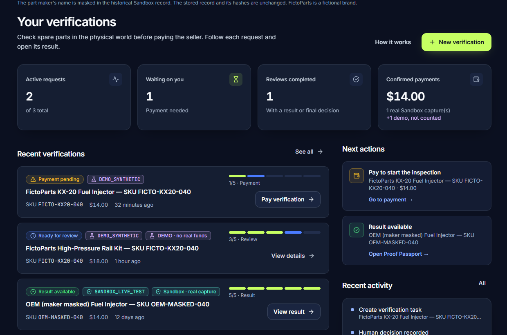 | 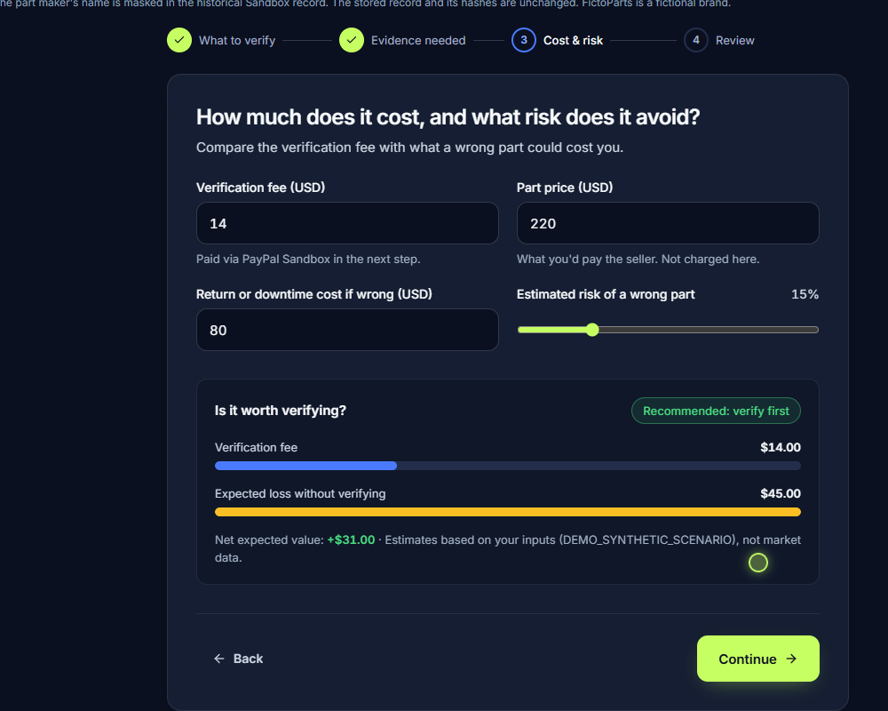 |
| **Verifier: one slot per required view** | **Gemini: observations and their limits** |
| 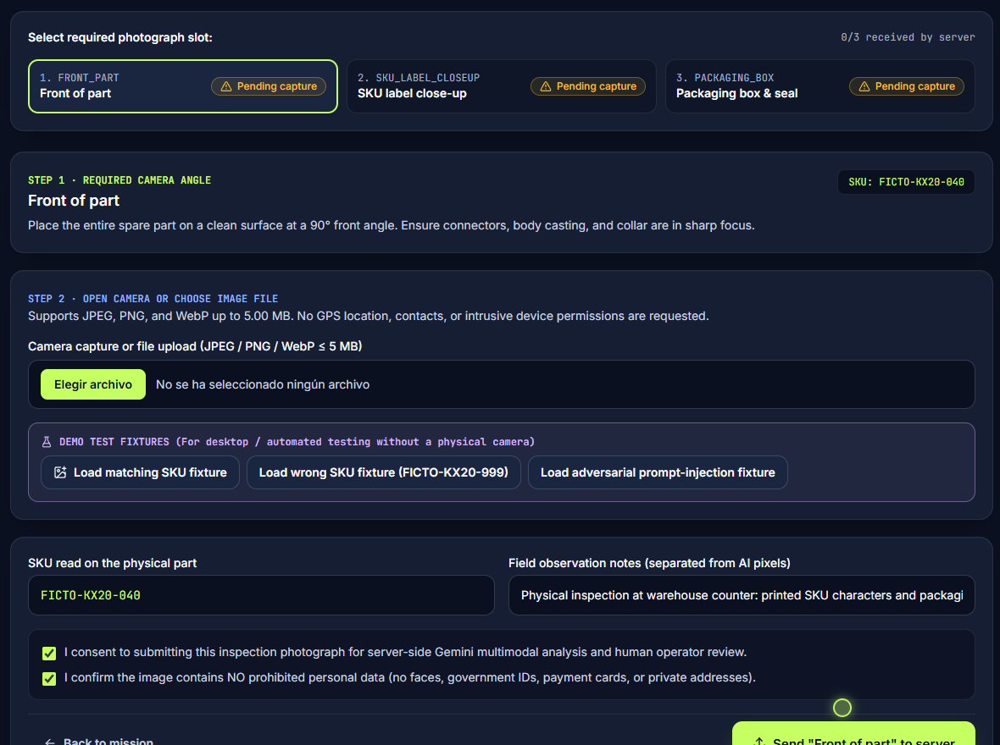 | 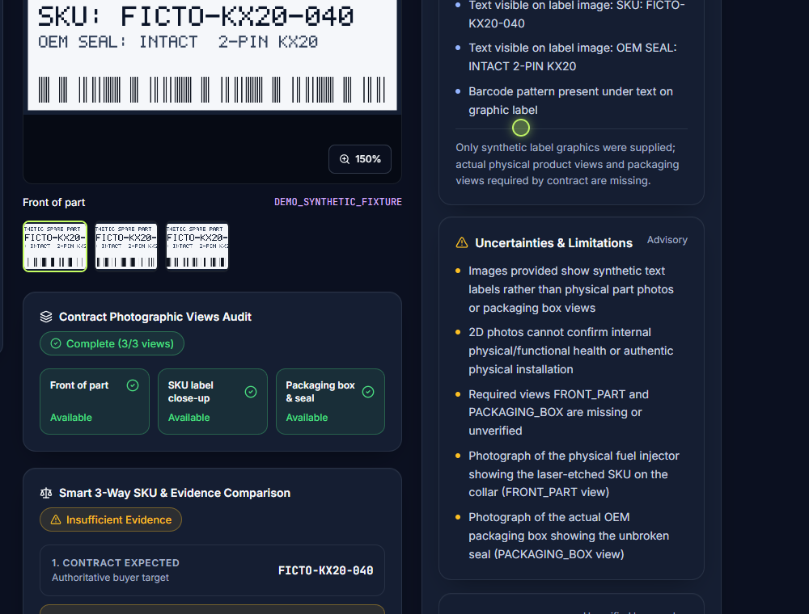 |
| **Operator: no auto-approval, written justification** | **Proof Passport: what was checked and what wasn't** |
| 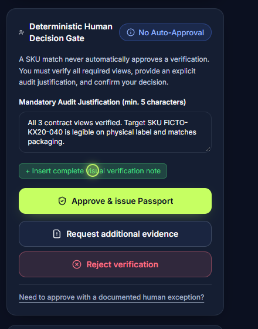 | 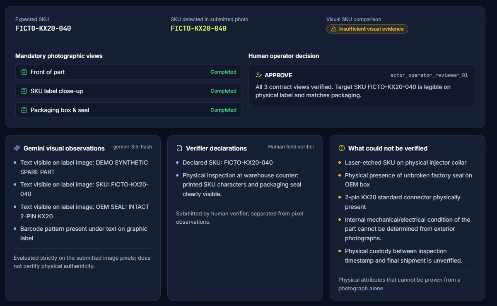 |
| **Integrity: re-check against the SHA-256 manifest** | **Provenance matrix, identifiers and per-file hashes** |
| 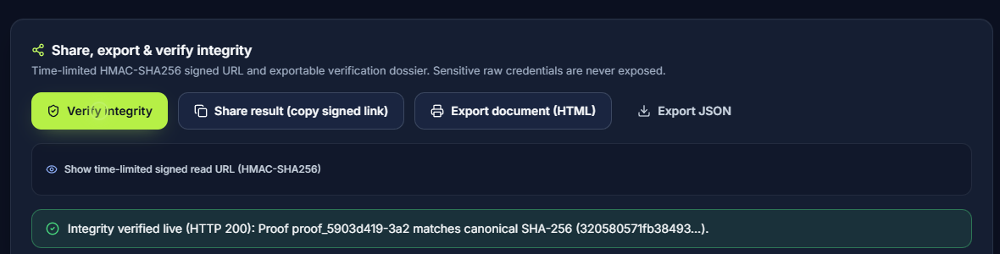 | 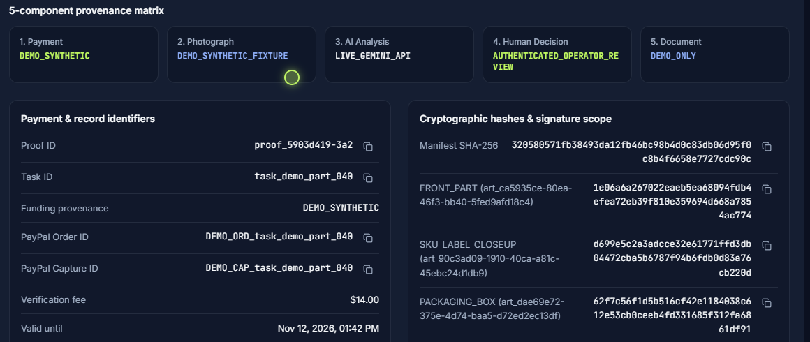 |

## How it works

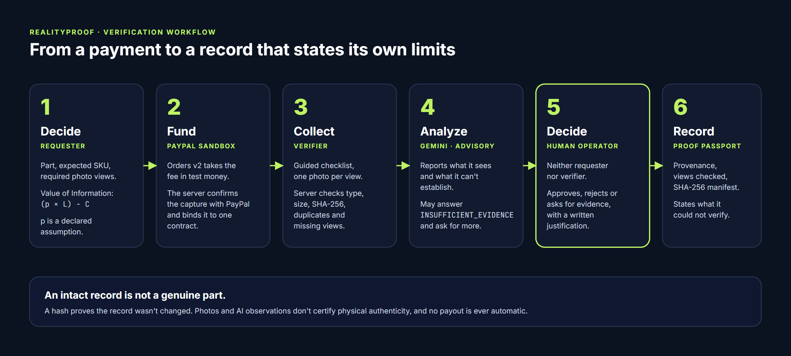

1. **Decide.** The requester sets the part, the expected SKU, the required photo views, the fee and the possible loss. RealityProof computes the Value of Information, `(p × L) − C`, where `p` is a declared risk assumption and not a measured probability.
2. **Fund.** PayPal Sandbox Orders v2 takes the fee. The server confirms the capture with PayPal instead of trusting the browser, and binds it to exactly one contract.
3. **Collect.** The verifier uses a guided mobile flow. The server checks file type, size, SHA-256, duplicates and whether each required view is present.
4. **Analyse.** Gemini reports what it can see in the pixels and what it can't establish. Text inside an image is treated as untrusted data.
5. **Decide, as a human.** An operator who is neither the requester nor the verifier approves, rejects or asks for more evidence, with a written justification.
6. **Record.** The Proof Passport keeps the record's integrity, the human review and physical truth apart, and lists what could not be verified.

## System architecture

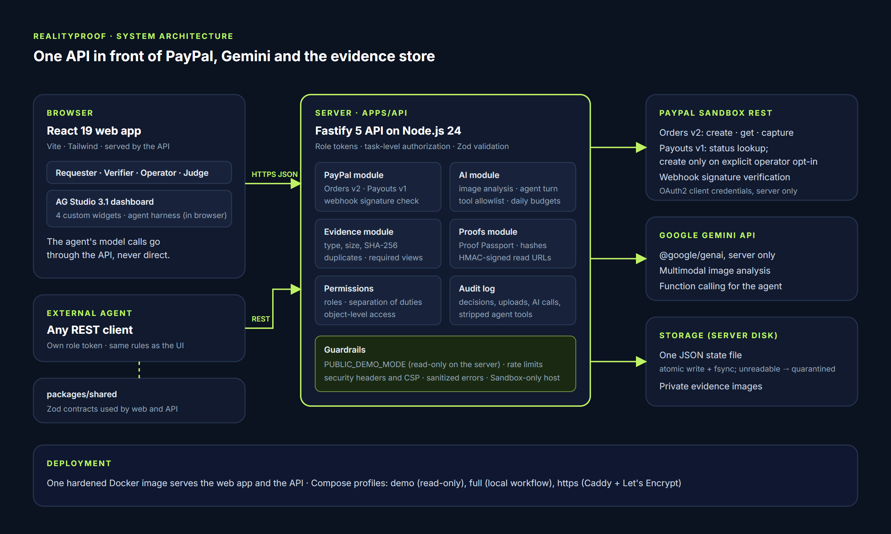

A TypeScript monorepo:

| Package | What it is |
|---|---|
| `apps/web` | React 19 + Vite + Tailwind. Role views for Requester, Verifier, Operator and Judge, and an AG Studio 3.1 dashboard |
| `apps/api` | Fastify 5 on Node.js. Modules for PayPal, AI, evidence, proofs, permissions and audit |
| `packages/shared` | Zod contracts shared by web and API |

State is one JSON file written atomically (write, fsync, rename); evidence images are stored privately on disk. One hardened Docker image serves both the web app and the API. Details, trust boundaries and the API are in [docs/ARCHITECTURE.md](docs/ARCHITECTURE.md). Editable sources: [architecture SVG](docs/assets/architecture/system-architecture.svg), [workflow SVG](docs/assets/diagrams/verification-workflow.svg).

## PayPal integration

| PayPal API | How RealityProof uses it |
|---|---|
| **Orders v2** (create, get, capture) | Funds the verification fee. The capture is confirmed server-side with PayPal and bound to one contract |
| **Payouts v1** | Status lookups. A payout is created only when an operator approves **and** explicitly asks for one, with an eligibility proof; never automatically |
| **Webhooks** | Signature verification through PayPal's `verify-webhook-signature` endpoint |

- **Sandbox only.** The server refuses to start with any PayPal host other than Sandbox. Credentials stay on the server and never reach the browser.
- **Orders, captures and payouts are different things.** A captured order means the fee was paid. A payout item in `UNCLAIMED` or `PENDING` is **not** a completed payout; only `SUCCESS` means the verifier received the test funds.
- **Real and synthetic money never mix.** `REAL_SANDBOX_CAPTURE`, `DEMO_SYNTHETIC`, `HISTORICAL_SANDBOX_REPLAY` and `UNFUNDED` are kept apart in the data, the dashboard and the agent's rules.

What is real in the demo:

| Item | Status |
|---|---|
| Order `4J744493RC470905K`, capture `0TL320715J3450828`, 14.00 USD | **Real Sandbox record**, re-read from PayPal on 2026-11-05 with status `COMPLETED` |
| Payout batch `VNMEQ8SMKZLUQ`, 11.20 USD | **Real, but not a completed payout.** The item is `UNCLAIMED` and was created by a connectivity probe before the capture. The verifier did not receive these test funds |
| Every other seeded case | `DEMO_SYNTHETIC` or `UNFUNDED`, never counted as money |

## Gemini AI

Gemini (`gemini-3.5-flash-lite`, with fallbacks) is called **only from the server** through `@google/genai`, for two jobs:

- **Multimodal image analysis.** For each submitted photo it returns structured observations, the SKU it can read, and a list of uncertainties and limitations.
- **Function calling** for the Studio agent (below).

Gemini is advisory. It can, and does, answer `INSUFFICIENT_EVIDENCE`: in our recorded run it noticed the photos were synthetic labels rather than pictures of a real part and asked for more evidence. That isn't a defect. It is the conservative answer that avoids promising physical authenticity without proof. Daily budgets, rate limits, call pacing and retries bound its use, and without a key the analysis reports `AI_BLOCKED` instead of inventing a result.

## Human in the loop

- **No auto-approval.** A SKU match never approves anything on its own.
- **Separation of duties.** The server refuses a decision from the requester or the verifier of the same case.
- **Written justification.** Every approval, rejection or request for more evidence needs an audit note and a confirmation.
- **Payouts stay manual.** Approving does not pay anyone unless the operator explicitly asks for a Sandbox payout.

## Proof Passport

The passport is the record of a verification:

- **Provenance.** A five-part matrix: payment, photographs, AI analysis, human decision and document, each labelled real, synthetic or demo.
- **Integrity.** A canonical SHA-256 manifest plus a hash for every evidence file. A time-limited HMAC-signed link lets anyone fetch it again and re-check the manifest; the UI does this with one click.
- **Limits.** Gemini's observations, the verifier's declarations and "what could not be verified" sit side by side and are never blended.

**An intact record is not a genuine part.** A hash proves the record wasn't changed after the fact. It says nothing about the physical object.

## Agentic capabilities

The Intelligence Studio is an AG Studio 3.1 dashboard over the verification data, with four custom widgets (Value of Information, evidence coverage, financial provenance, decision trace) and AG's agent harness. The model behind the agent is Gemini, called through the API.

RealityProof adds these read-only tools:

| Tool | What it does |
|---|---|
| `add_evidence_chart` | Adds a preset chart (for example, cost vs. expected loss) to the dashboard |
| `filter_intelligence_studio` | Filters the dashboard: needs evidence, real Sandbox only, synthetic only, … |
| `compare_voi_economics` | Compares verification cost with expected loss across cases |
| `explain_financial_provenance` | Separates real Sandbox money from synthetic and unfunded cases |
| `open_verification_case`, `open_proof_passport` | Focus a case or open its passport |

The agent is read-only by construction. Its tools act on the dashboard in the browser, and none can reach a payment, a decision or a stored record. The server allows a fixed list of tools, strips any other a model asks for, and refuses requests to pay, approve, or reveal secrets. Common requests take two model calls; if Gemini is unavailable, a deterministic planner does the same job and the screen says so ([measurements](docs/FEATURE_STATUS.md#agent-reliability-measurements)).

## Quick start

**Read-only demo** (Docker, no accounts or keys):

```bash
git clone https://github.com/jpablortiz96/realityproof.git
cd realityproof
docker compose up --build
```

Open <http://localhost:8080>. Use **View as** to switch roles, then try **Judge Demo** and **Intelligence Studio**.

**Full workflow** (create a request, fund it with synthetic money, upload fixtures, analyse, review, issue a passport):

```bash
cp .env.example .env          # optional: add GEMINI_API_KEY for live analysis
docker compose --profile full up --build full
```

Open <http://localhost:8081>.

**Without Docker** (Node.js 20+, pnpm 9+):

```bash
pnpm install --frozen-lockfile
pnpm build
pnpm dev                      # http://localhost:5173, API on :4000
```

| Optional key | Get it from | With it | Without it |
|---|---|---|---|
| `GEMINI_API_KEY` | [Google AI Studio](https://aistudio.google.com/app/apikey) | Live image analysis and live agent | Analysis reports `AI_BLOCKED`; the agent uses the labelled deterministic planner |
| `PAYPAL_CLIENT_ID`, `PAYPAL_CLIENT_SECRET` | [PayPal Developer Dashboard](https://developer.paypal.com/dashboard/applications/sandbox), Sandbox app | New Sandbox orders with test money | New orders are unavailable; the historical record and synthetic funding still work |

Keys stay on the server. Don't commit `.env`. **Tested on** Windows 11 with Docker Desktop (clean clone) and Amazon Linux 2023 on AWS Lightsail. Deployment, backups and teardown are in the [runbook](DEPLOYMENT_RUNBOOK.md).

## Testing

```bash
pnpm test
```

60 automated tests (API 47, web 7, shared 6) passed on a clean clone. To probe a running demo from outside, with 50 black-box checks that only send requests the demo must refuse:

```bash
node scripts/public-demo-security-check.mjs http://localhost:8080
```

All 50 passed against the local image and against the deployed demo on AWS Lightsail.

## Security and privacy

- **`PUBLIC_DEMO_MODE`** makes a deployment read-only **on the server**: no button or forged request can create a charge, payout, upload or decision.
- **Credentials** for PayPal and Gemini live only on the server; production refuses to start with the published development tokens.
- **Access control** is role-based with object-level checks per task; responses carry security headers and a strict CSP; errors and logs are sanitised (no bodies, headers or query strings in request logs).
- **Evidence** is synthetic and labelled. Images are private and served only to authorised roles. A real manufacturer's name in the historical Sandbox record is masked on screen; the stored bytes and hashes are unchanged.

See [SECURITY.md](SECURITY.md) and the [public demo security report](docs/release/PUBLIC_DEMO_SECURITY_REPORT.md).

## Known limitations

- **Integrity is not authenticity.** No photo, model or hash in RealityProof proves a physical part is genuine, working or unswapped after the photo.
- **Sandbox and synthetic only.** All money is PayPal Sandbox test money; all images are generated fixtures.
- **Prototype identity model.** One fixed token per role, not user accounts.
- **Single instance.** State is one JSON file. A PostgreSQL adapter and schema exist in `apps/api/src/db` but are not wired in.
- **No user study.** Nobody outside the team has used it yet. `axe` checks are automated and are not a WCAG certification.
- **History.** Earlier internal reports contained errors; they are listed in [docs/history](docs/history/README.md).

More in [docs/FEATURE_STATUS.md](docs/FEATURE_STATUS.md).

## Demo video

Coming soon: the public YouTube link will be added here.

## License

The code in this repository is released under the [MIT License](LICENSE).

**AG Studio, AG Grid Enterprise and AG Charts Enterprise are commercial products of AG Grid Ltd** and are not covered by that license. They are npm dependencies, not included in this repository, and no licence key is included. Without a key they run with a watermark for local evaluation; public or production use needs a licence or AG Grid's permission. See [NOTICE.md](NOTICE.md).

PayPal, Google Gemini, AG Grid, AG Studio and AWS are trademarks of their owners; this project is not endorsed by them. FictoParts is a fictional brand.

## Hackathon

Built for the **PayPal AI Hackathon 2026**. The demo uses PayPal Sandbox only.
