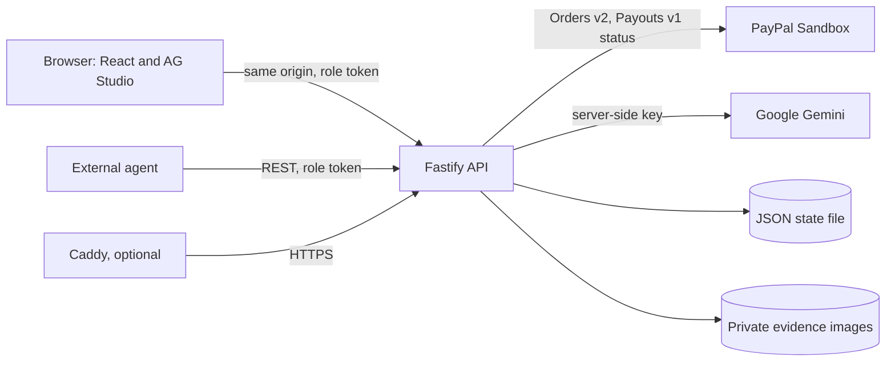
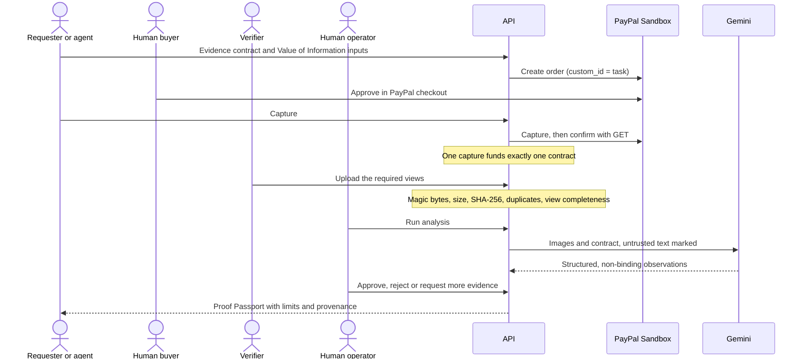
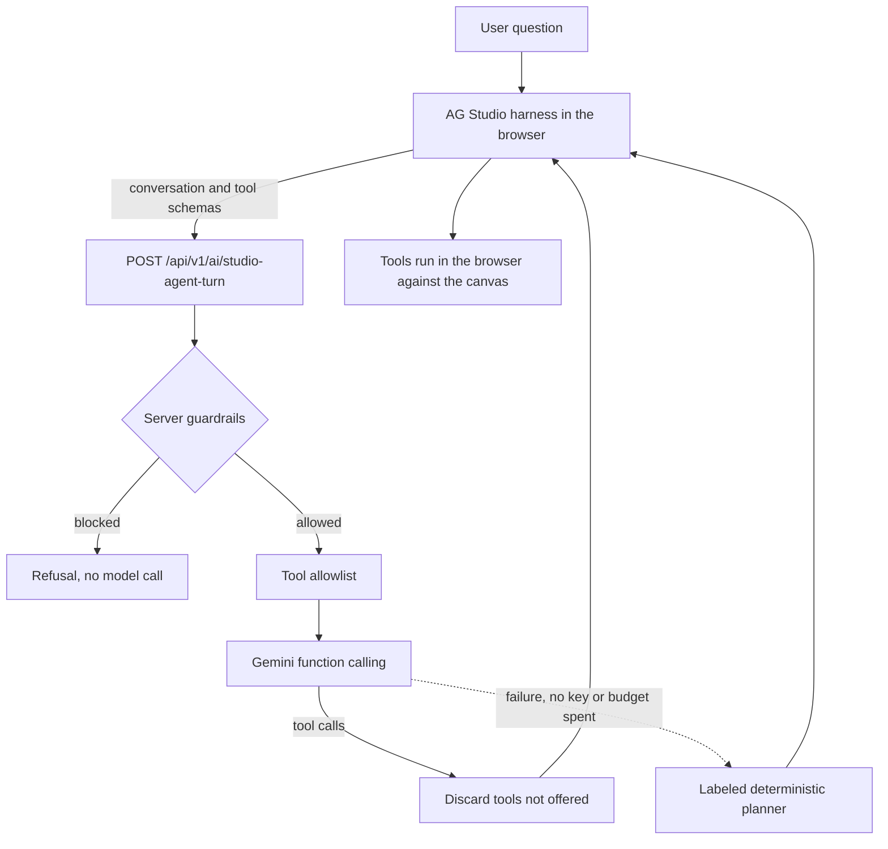

# Architecture

This describes the code as it runs today. Older design documents are in [`docs/history/`](history/README.md).

## Components

| Part | Technology | Notes |
|---|---|---|
| `packages/shared` | TypeScript, Zod | Evidence contract, passport and analysis schemas, Value of Information calculation, evidence completeness rules. |
| `apps/api` | Node.js 24, Fastify 5 | Business rules, RBAC, PayPal and Gemini integrations. Also serves the web bundle when `WEB_DIST_DIR` is set. |
| `apps/web` | React 19, Vite, Tailwind | Requester, Verifier, Operator and Judge tour views, and the AG Studio dashboard. |
| Storage | JSON file and files on disk | One writer process. Writes go to a temporary file, are flushed and renamed, so a crash cannot leave half a file. An unreadable file is moved aside rather than overwritten. |

The `pg` dependency and `apps/api/src/db/` hold an **unused** PostgreSQL path; nothing at runtime calls them. This storage suits a single-instance demo and would not suit production.

## Verification flow

## Trust boundaries

- **Secrets stay on the server.** PayPal and Gemini keys never reach the browser. `VITE_AG_STUDIO_LICENSE_KEY` is the exception by design: anything prefixed `VITE_` is in the public bundle.
- **Sandbox only.** Startup fails if `PAYPAL_MODE` or `PAYPAL_API_BASE_URL` points anywhere but PayPal Sandbox.
- **Models advise, people decide.** No Gemini output changes a financial state or issues a passport. Only an authenticated operator can, and not on a task they created or submitted evidence for.
- **Authorization is on the server.** A role comes from a validated token, never a client claim. Requesters and external agents reach only tasks they created; verifiers reach funded work offered to them or assigned to them.
- **Demo tokens are not real identity.** There is one fixed token per role. This is enough to demonstrate role separation and is not a user account system. In production the API refuses to start on published tokens unless `PUBLIC_DEMO_MODE=true`.

## Public demo mode

`PUBLIC_DEMO_MODE=true` is deny-by-default in a server hook, before any route runs. The only writes allowed are the Value of Information calculator and the Studio agent. Every order, capture, payout, evidence upload, analysis, review and webhook returns `403 PUBLIC_DEMO_READ_ONLY`, whichever token is used, and so does the one read that would call PayPal. State stays in memory and is reseeded on start. In Compose, the demo service never receives PayPal credentials.

## Intelligence Studio agent

The agent is read-only by construction. Every tool it can call acts on the dashboard in the browser, and none reaches a payment, a review decision or a stored record. Prompt guardrails are an extra layer, not the guarantee.

- `add_evidence_chart` places a real AG Studio widget over the same data source from a fixed preset. It needs one tool call, and the planner can issue it with no model at all. This is the dependable way to get a chart.
- AG's own lead, page and widget agents can also design a chart from scratch. That takes many model calls and is **experimental**.
- Calls are paced and retried with backoff inside a 45-second turn deadline. Agents have step limits, a run is cancelled after 90 seconds, and a daily budget caps Gemini turns and analyses.

When the planner answers instead of Gemini, the interface shows a `DETERMINISTIC FALLBACK` label and the API reports it in `meta.engine`.

## Value of Information

`net benefit = (p × L) − C`: `p` is the requester's declared risk assumption, `L` the loss if wrong, and `C` the verification fee. `p` is an assumption, not a measured probability.

## API surface

| Method and path | Roles | Purpose |
|---|---|---|
| `GET /health`, `GET /ready` | Public | Liveness and readiness |
| `GET /api/v1/system/capabilities` | Public | Configuration status, no secrets |
| `POST /api/v1/economics/voi` | Public | Value of Information calculator |
| `POST /api/v1/verification-requests` | Requester, agent, operator | Create a contract |
| `GET /api/v1/verification-requests[/:id]` | All, scoped | Read tasks |
| `POST .../:id/funding/create-order` | Requester, agent, operator | Create a Sandbox order |
| `POST .../:id/funding/capture-order` | Requester, agent, operator | Capture after buyer approval |
| `POST .../:id/funding/simulate-demo-funding` | Requester, agent, operator | Synthetic, non-payable funding |
| `POST .../:id/assign`, `POST .../:id/evidence` | Verifier | Accept work and upload views |
| `POST .../:id/analyze` | Verifier, operator, requester | Run Gemini analysis |
| `POST .../:id/review` | Operator | Human decision; issues the passport |
| `GET /api/v1/proofs/:id` | Signed link or authorized role | Read a Proof Passport |
| `GET /api/v1/analytics/*` | Requester, agent, operator, scoped | Dashboard rows and summary |
| `POST /api/v1/ai/studio-agent-turn` | Requester, agent, operator | One agent turn |
| `GET /api/v1/audit-events` | Operator | Audit trail |

There is no SDK and no MCP server. External agents use this REST API with a role token.
